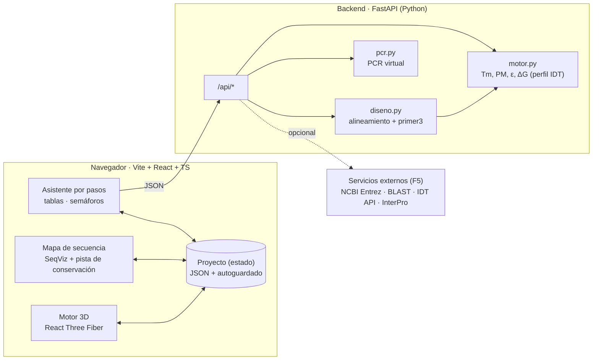

# Arquitectura

## 1. Vista general



Regla: **el navegador dibuja, Python calcula.** Ningún cálculo científico se duplica en TypeScript,
salvo trivialidades instantáneas (complemento reverso, %GC, largo) para que la UI responda al teclear.

## 2. Capa 1 · UI y mapa de secuencia

| Pieza | Elección | Notas |
|---|---|---|
| Framework | **Vite + React 18 + TypeScript** | SPA. Next.js no aporta nada con backend FastAPI. |
| Mapa | **SeqViz** (`viewer="linear"`) | Props usadas: `seq`, `primers` (`{start, end, name, direction: 1/-1, color}`), `highlights` (posiciones variables), `annotations` (amplicón, sonda), `selection` + `onSelection` (región blanco), `search`. Índices base 0, `end` exclusivo. |
| Lectura de archivos | Parser FASTA propio (10 líneas, `lib.ts`) | **seqparse** (de los autores de SeqViz) cuando haga falta GenBank / SnapGene. SeqViz depreca su prop `file`. |
| Gráficas | **SVG a mano** | Pista de conservación, mapa de calor de dímeros, gel virtual: son rectángulos. Sin librería de gráficas. |
| Esquema MultAlin | **SVG a mano** (`<text>` monoespaciado + `<rect>` de color) | Mismos colores y línea de consenso que MultAlin, con los primers encima. Se exporta tal cual (SVG) o rasterizado (PNG con `canvas`). |
| Estado | **`useState`** con el objeto `Proyecto`, pasado por props a cada paso | Zustand sólo si crece. Autoguardado en `localStorage` (con `try/catch`); guardar/abrir = descargar/subir `.json`. |
| Estilos | CSS simple con variables | Sin librería de componentes. Colores fijos: F verde, R rojo, sonda azul, variable naranja. |

Vista de alineamiento completo (15 filas × 1 kb): en F2 basta el consenso + pista de conservación + tooltip
con la composición. Si hace falta ver las filas, se añade `react-msaview` (§8).

## 3. Capa 2 · Motor 3D

**React Three Fiber + drei** (OrbitControls, Html para etiquetas). La geometría es **B-DNA idealizada
generada por fórmula**: ilustrativa, no una predicción estructural (decirlo así en la tesis).

| Parámetro | Valor |
|---|---|
| Elevación por par de bases | 3.38 Å |
| Giro por par de bases | 34.3° (10.5 pb/vuelta) |
| Radio del esqueleto | 10 Å |
| Desfase entre hebras | ≈ 140° (deja visibles surco menor y mayor) |
| Colores de base | A verde · T rojo · G amarillo · C azul (o por hebra) |

Componentes:

| Componente | Entrada | Qué dibuja |
|---|---|---|
| `<Helice>` | `seq` del amplicón, marcas `[{inicio, fin, color, hebra}]` | 2 esqueletos (`TubeGeometry` sobre `CatmullRomCurve3`) + peldaños con `InstancedMesh` (600 pb = 600 instancias, trivial). F y R brillan sobre su hebra con flecha en 3′. |
| `<Dimero>` | `a`, `b`, `pares_bases: [[i, j]]` | Dúplex sólo donde hay apareamiento, colas sueltas, esfera en cada 3′; rojo si el 3′ está apareado. |
| `<Horquilla>` | `seq`, `pares_bases` | Tallo como mini-hélice + lazo como arco. |

`pares_bases` lo calcula el backend a partir de la estructura de primer3 (`output_structure=True`);
el frontend no interpreta termodinámica. Siempre hay respaldo 2D (dibujo ASCII como IDT) al lado.

Animaciones (después de F4, educativas): desnaturalización → hibridación del primer → extensión desde 3′.

## 4. Capa 3 · Motor de cálculo (backend)

| Pieza | Elección |
|---|---|
| API | **FastAPI** + Pydantic (validación de entrada en la frontera: alfabeto, largos, concentraciones > 0) |
| Tm, PM, ε, ΔH/ΔS | **Biopython** `Bio.SeqUtils.MeltingTemp` + tablas IDT (ver MOTOR_CALCULO.md) |
| Horquillas, dímeros, 3′, diseño | **primer3-py** (`calc_hairpin`, `calc_homodimer`, `calc_heterodimer`, `calc_end_stability`, `design_primers`) |
| Alineamiento | Atajo sin MSA si no hay indels; si no, **pyfamsa** (wheel de pip, sin binarios). MAFFT por `subprocess` como respaldo. O **importado de MultAlin** (`.mul` / `.msf`, se leen con `Bio.AlignIO`, formatos `fasta` y `msf`). |
| PCR virtual | **numpy** (ya viene con Biopython): ventanas deslizantes vectorizadas |
| XLSX / GenBank | `openpyxl` / `Bio.SeqIO` |

### 4.1 Contrato de la API

Todo es `POST` con JSON. Las concentraciones viajan siempre con el preset: `{oligo_uM, na_mM, mg_mM, dntp_mM}`.

**`POST /api/analizar`** — el "OligoAnalyzer"
```jsonc
// petición
{ "oligos": [{ "nombre": "Saureus_nuc_cF", "seq": "CTGAAGCAAGTGCATTTACGA" }],
  "condiciones": { "fabrica": { "oligo_uM": 0.25, "na_mM": 50, "mg_mM": 0, "dntp_mM": 0 },
                   "pcr":     { "oligo_uM": 0.4,  "na_mM": 50, "mg_mM": 2, "dntp_mM": 0.2 } },
  "perfil": "tesis" }
// respuesta
{ "motor": "0.1.0",
  "oligos": [{
    "nombre": "Saureus_nuc_cF", "seq": "CTGAAGCAAGTGCATTTACGA",
    "largo": 21, "gc_pct": 42.9, "pm": 6454.3, "eps260": 209400, "nmol_od": 4.78, "ug_od": 30.82,
    "dh": -164.4, "ds": -448.2, "dg_duplex_37": -25.4,
    "tm": { "fabrica": 52.1, "pcr": 60.3 },
    "horquilla": { "dg": -1.14, "tm": 43.0, "ascii": ["..."], "pares_bases": [[3, 15]] },
    "autodimero": { "fabrica": { "dg": -3.94, "ascii": ["..."] }, "pcr": { "dg": -4.76 } },
    "estabilidad_3p": -5.53, "pinza_gc": 2, "poly_x": 3,
    "banderas": [] }] }
// banderas cuando algo no está en verde: { "regla": "poly_x", "valor": 4, "umbral": 3, "nivel": "amarillo" }
```

**`POST /api/dimeros`** — matriz de un tubo
```jsonc
{ "oligos": [{ "nombre": "...", "seq": "..." }], "condicion": { "...": "preset pcr" } }
// →
{ "nombres": ["Sa_F", "Sa_R"], "matriz": [[-3.94, -1.2], [-1.2, -0.14]],
  "pares": [{ "a": "Sa_F", "b": "Sa_R", "dg": -1.2, "anclaje_3p": 0.5, "ascii": ["..."],
              "pares_bases": [[0, 4]], "nivel": "verde" }] }
```

**`POST /api/alinear`**
```jsonc
{ "secuencias": [{ "id": "SAUR01_CP000730.1_TCH1516", "seq": "ATG..." }],
  "ya_alineado": false,              // true si viene de MultAlin (.mul/.msf): no se re-alinea
  "consenso_alto": 1.0, "consenso_bajo": 0.5 }   // umbrales del esquema MultAlin
// →
{ "filas": [{ "id": "...", "seq": "ATG-..." }], "consenso": "ATG...",
  "conservacion": [1.0, 1.0, 0.67],
  "consenso_multalin": "ATGACAGAaTAC...",   // mayúscula ≥ alto, minúscula ≥ bajo, "." si no
  "variables": [{ "pos": 42, "mayoritaria": "T", "composicion": { "T": 10, "C": 5 },
                  "cepas": { "SAUR01_CP000730.1_TCH1516": "C" } }],
  "resumen": { "total": 687, "con_hueco": 0, "C": 659, "V": 28, "Pi": 14, "S": 14 },
  "bloques": [{ "inicio": 404, "fin": 428, "largo": 25 }] }
```

**`POST /api/disenar`**
```jsonc
{ "consenso": "ATG...", "conservacion": [1.0], "region": { "inicio": 300, "fin": 650 },
  "tamanos": [[150, 600]], "excluir_tamanos": [[290, 330]],
  "oligos_del_tubo": [{ "nombre": "...", "seq": "..." }],
  "condiciones": { "...": "..." }, "perfil": "tesis", "n": 20, "sonda": false }
// →
{ "candidatos": [{ "id": "p1", "puntaje": 91,
                   "F": { "...": "InformeOligo + inicio/fin/hebra" }, "R": { "...": "..." },
                   "producto": { "inicio": 403, "fin": 572, "tamano": 169, "gc_pct": 36.7, "seq": "..." },
                   "banderas": [], "desglose": [{ "regla": "dTm", "puntos": -2 }] }],
  "descartados": [{ "F": "...", "R": "...", "motivos": ["heterodimero -9.8 < -9"] }] }
```

**`POST /api/pcr-virtual`**
```jsonc
{ "pares": [{ "nombre": "Saureus_nuc", "F": "CTG...", "R": "GCA..." }],
  "secuencias": [{ "id": "...", "especie": "Staphylococcus aureus", "seq": "..." }],
  "max_desajustes": 2, "tamano_max": 3000, "cruzados": true }
// →
{ "resultados": [{ "par": "Saureus_nuc", "secuencia": "...", "producto": true, "tamano": 169, "desajustes": "0/0" }],
  "resumen": [{ "par": "Saureus_nuc", "propia": "15/15", "otras": 0, "tamanos": [169] }] }
```

**`POST /api/verificar-oligos`** — `{ encabezados, filas, condiciones }` (tu tabla tal cual) → la misma tabla con
`{ tuyo, calculado, diferencia, estado: ok|aprox|no, nota }` por celda. La tabla de posiciones se verifica en el
navegador contra los alineamientos cargados (`ubicarPrimer` en `lib.ts`).

**Conexiones externas** (`externos.py`; credenciales sólo en variables de entorno, ver README):
- `POST /api/ncbi/secuencias` — `{ consulta, maximo }` (búsqueda de nuccore o accesiones `ACC[:[c]ini-fin]`) → `{ fasta }`.
- `POST /api/ncbi/blast` — `{ oligos, excluir: [especies] }` → `{ rid, espera_s }`. Una sola búsqueda blastn-short contra
  core_nt sin las especies del panel (entre ellas ya revisa la PCR virtual).
- `POST /api/ncbi/blast/resultado` — `{ rid, pares }` → `{ estado: esperando|listo, sitios, productos }`. El navegador
  pregunta una vez por minuto (regla de NCBI) y guarda el RID en el proyecto para retomarlo.
- `POST /api/idt` — `{ oligos, condiciones, clave }` → valores del OligoAnalyzer oficial (Analyze, Hairpin, SelfDimer).
  403 si la clave no coincide con `PRIMERFLOW_CLAVE`.

**`POST /api/exportar/{xlsx|genbank}`** (pendiente) — CSV, FASTA, pedido IDT y `.json` se generan en el navegador.

## 5. Estructura de carpetas (objetivo)

```text
collettetesis/
├── docs/                    ← este plan
├── backend/
│   ├── app.py               ← rutas FastAPI (delgadas)
│   ├── motor.py             ← Tm, PM, ε, estructuras, perfiles de calculadora, criterios
│   ├── diseno.py            ← alineamiento, conservación, primer3, ranking, multiplex
│   ├── pcr.py               ← PCR virtual, amplicones, gel
│   ├── verificar.py         ← compara una tabla pegada contra el motor, celda por celda
│   ├── test_motor.py        ← pruebas doradas desde el Excel
│   └── requirements.txt
├── frontend/
│   ├── index.html
│   └── src/
│       ├── App.tsx          ← stepper + estado del proyecto
│       ├── api.ts
│       ├── pasos/           ← un archivo por paso del asistente
│       └── componentes/     ← MapaSecuencia, EsquemaMultAlin, FichaOligo, MatrizDimeros, Gel, Helice3D
└── *.fasta, *.xlsx         ← tus datos, en la raíz (las pruebas los leen de ahí)
```

Pocos archivos a propósito: se parte un módulo cuando pase de ~400 líneas, no antes.

## 6. Ejecución y despliegue

- **Desarrollo:** `uvicorn app:app --app-dir backend --port 8765 --reload` + `npm run dev` (Vite con proxy `/api` → `:8765`; el 8000 ya lo usa otro programa en esta máquina).
- **Uso diario / tesis:** `npm run build` y FastAPI sirve `frontend/dist` como estático → **un solo comando**,
  una sola URL (`http://127.0.0.1:8765`).
- **Web pública (si se decide):** el mismo contenedor en cualquier PaaS (Render, Fly, Railway). Sin base de datos
  no hay nada más que desplegar.
- Credenciales externas (IDT API, NCBI API key, email de Entrez) sólo en variables de entorno del backend.

## 7. Pruebas

- **Doradas:** cada hoja del Excel es una prueba (`M3_IDT_oligos`, `M3_IDT_dimeros`, `M2_archivos`,
  `M2_primers`, `M4_PCR_virtual`, `M6_amplicones`, `M7_mezcla_calculadora`). Hoy pasan M2, M3 y M4 (`backend/test_motor.py`).
- **Calibración por calculadora:** un CSV por calculadora externa con valores capturados (MOTOR_CALCULO.md §7).
- **UI:** a mano con los 9 FASTA hasta F3; pruebas e2e sólo si la app se publica.

## 8. Proyectos y servicios en los que nos apoyamos

### Usamos directamente

| Proyecto | Para qué | Licencia |
|---|---|---|
| [primer3](https://github.com/primer3-org/primer3) / [primer3-py](https://github.com/libnano/primer3-py) | Diseño de pares, sonda qPCR, horquillas, dímeros, estabilidad 3′ (thal) | GPL-2.0 |
| [Biopython](https://github.com/biopython/biopython) | Tm por vecino más cercano (8 tablas, 7 correcciones de sal, DMSO/formamida), FASTA/GenBank, Entrez, BLAST, traducción | Biopython / BSD-3 |
| [SeqViz](https://github.com/Lattice-Automation/seqviz) + [seqparse](https://github.com/Lattice-Automation/seqparse) | Mapa de secuencia con primers y selección; lectura de archivos | MIT |
| [React Three Fiber](https://github.com/pmndrs/react-three-fiber) + [drei](https://github.com/pmndrs/drei) | Escena 3D declarativa en React | MIT |
| [pyfamsa](https://github.com/althonos/pyfamsa) / [MAFFT](https://mafft.cbrc.jp/alignment/software/) | Alineamiento múltiple | GPL-3.0 / BSD |
| [FastAPI](https://github.com/fastapi/fastapi) | API | MIT |

### Referencias de diseño (leemos cómo lo hacen; no son dependencias)

| Proyecto | Qué tomamos |
|---|---|
| [varVAMP](https://github.com/jonas-fuchs/varVAMP) (Nat. Commun. 2025) | Diseño desde alineamientos: consenso, penalizar desajustes en 3′, primers degenerados, modo qPCR. Usa primer3 + seqfold, igual que nosotros. Si un gen es muy variable, su enfoque de bases degeneradas es el camino. |
| [MFEprimer-3.0](https://github.com/quwubin/MFEprimer-3.0) | Algoritmo de especificidad y dímeros para multiplex (filtro "sólo dímeros con 3′ apareado"). Web gratis; binario CLI. |
| [Primer3Plus](https://github.com/primer3-org/primer3plus) | Cómo exponer los parámetros de primer3 en una UI. |
| [pydna](https://github.com/pydna-group/pydna) | PCR simulada y ensamblajes, si la tesis pasa a clonación. BSD-3. |
| [primers](https://github.com/Lattice-Automation/primers) | Primers con colas (Gibson/restricción). MIT. |
| [seqfold](https://github.com/Lattice-Automation/seqfold) | Zuker puro Python (SantaLucia 2004): alternativa para horquillas y para el modo offline. MIT. |
| [OpenVectorEditor](https://github.com/TeselaGen/tg-oss) | Alternativa más pesada a SeqViz si algún día hay edición de plásmidos. |
| [react-msaview](https://github.com/GMOD/react-msaview) | Visor de alineamiento completo si el consenso no basta. |

### Servicios externos (opcionales; MultAlin desde F2, el resto en F5)

| Servicio | Uso | Notas |
|---|---|---|
| **[MultAlin](http://multalin.toulouse.inra.fr/multalin/)** (Corpet 1988, *NAR* 16:10881) | Alineamiento y esquemas de la tesis | Sin API: intercambio de archivos. Entrada FASTA; salidas `.mul` (FASTA alineado), `.msf`, GIF, HTML. Sólo `http://` (el servidor no acepta HTTPS). Defaults: consenso alto 90 %, bajo 50 %. |
| **IDT SciTools Plus API** | Contrastar automáticamente con la IDT real (incluida la horquilla UNAFold) para calibrar | OAuth con cuenta IDT (Client ID/secret). Endpoints en su Swagger. Ideal para cerrar las decisiones abiertas 1 y 2. |
| NCBI E-utilities (`efetch`) | Descargar secuencia por accesión + `seq_start`/`seq_stop`/`strand` | 3 peticiones/s sin API key; enviar `email` y `tool`. |
| NCBI BLAST URL API | BLASTn del amplicón | Asíncrono (RID); máx. 1 petición cada 10 s, sondear cada ≥ 1 min. |
| NCBI Primer-BLAST | Especificidad contra genomas completos | Sin API oficial → botón con los primers precargados. |
| UniProt REST / InterPro API | Proteína y dominios (Manual 5) | Sin autenticación. |

### Descartados

| Opción | Por qué no |
|---|---|
| UNAFold | Comercial (es lo que usa IDT para horquillas). Lo aproximamos con thal y calibramos con la API de IDT. |
| NUPACK | Licencia académica restrictiva. |
| 3Dmol.js | Pide coordenadas atómicas que no tenemos; la hélice procedural basta. |
| Rust/WASM | No hay un primer3 en Rust maduro; costo alto sin beneficio hoy. |

## 9. Modo offline (futuro, F5)

Si se necesita sin servidor: **Pyodide** en un Web Worker ya incluye Biopython (Tm, PM, ε idénticos) y
seqfold es Python puro (horquillas). Falta primer3: compilar `thal.c` con Emscripten (C sin dependencias).
No hay un port de primer3 a WASM mantenido. Sólo vale la pena si la app debe funcionar sin internet ni Python.

## 10. Riesgos

| Riesgo | Mitigación |
|---|---|
| primer3 es GPL-2.0 | Uso académico sin problema; si se distribuye la app, publicarla bajo GPL. |
| Horquilla ≠ IDT (UNAFold) | Tolerancia ±1.5 kcal/mol (tu manual); calibrar con la API de IDT; Tm de horquilla marcada "estimada". |
| Tm PCR difiere ~0.4 °C del Excel | Decisión abierta 1; perfil calibrable, la prueba dorada lo vigila. |
| MSA en Windows | Atajo sin MSA (8 de 9 archivos no lo necesitan) + pyfamsa por pip. |
| NCBI limita peticiones | Cola en el backend + caché por accesión. |
| 3D lento en amplicones largos | `InstancedMesh`; > 1 kb se muestra sólo la ventana alrededor del primer. |
